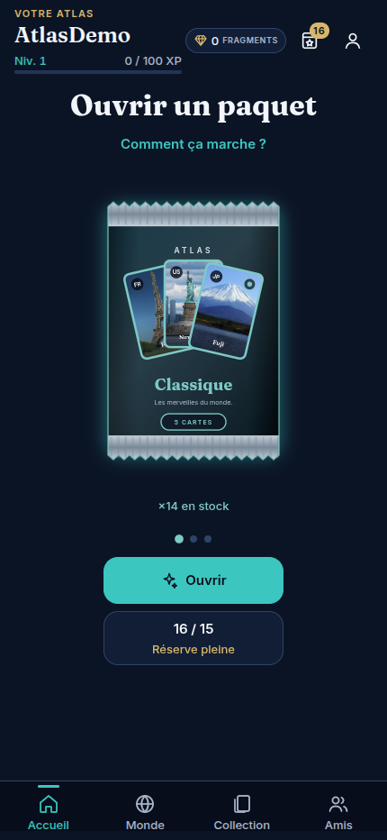
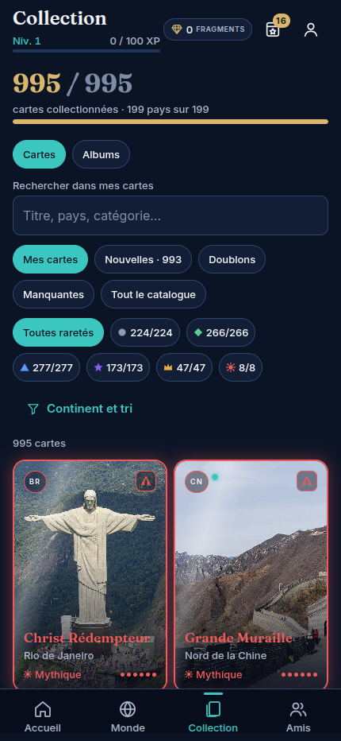
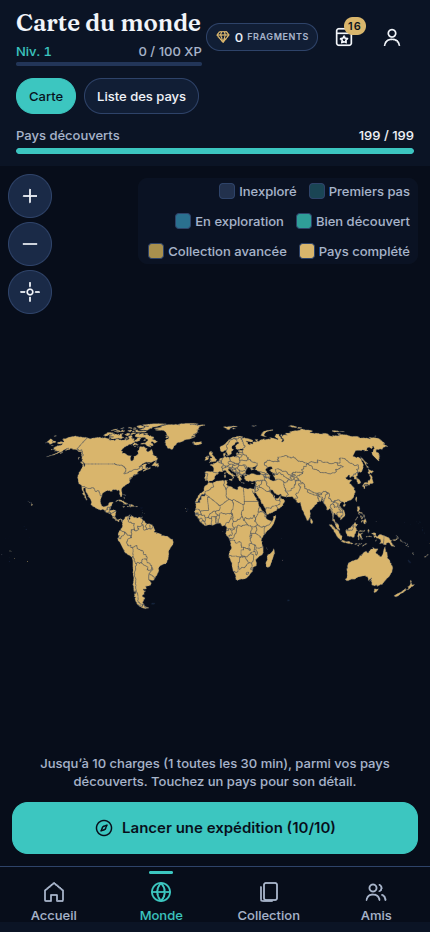
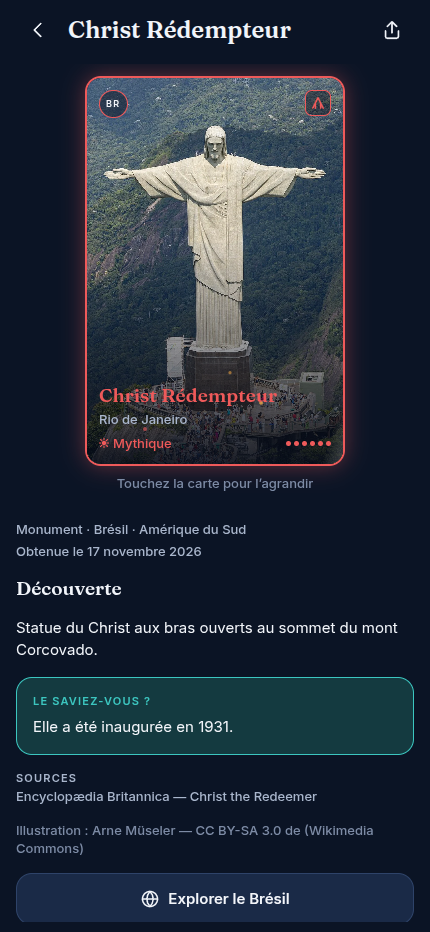
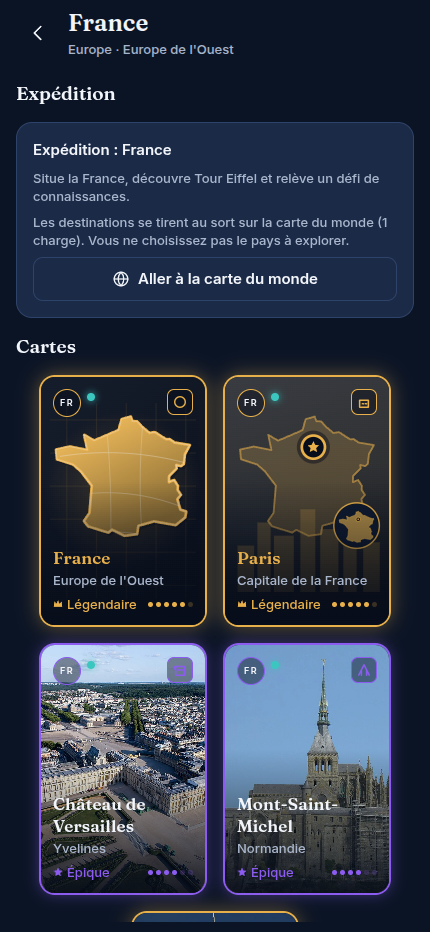
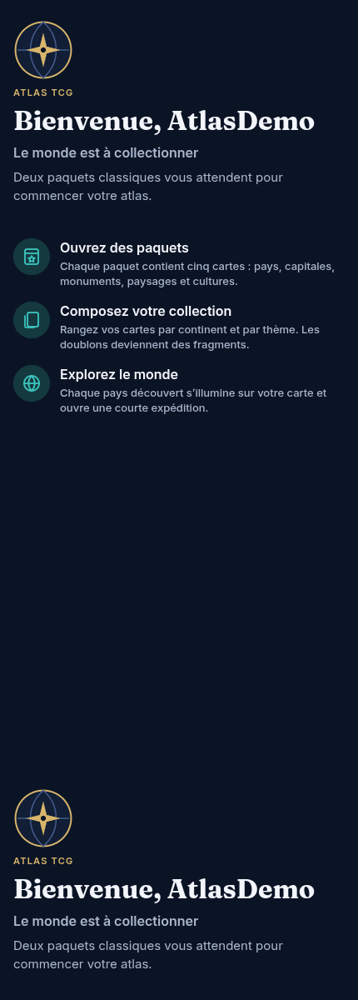
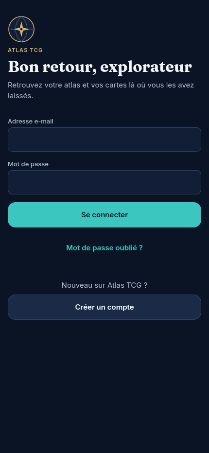
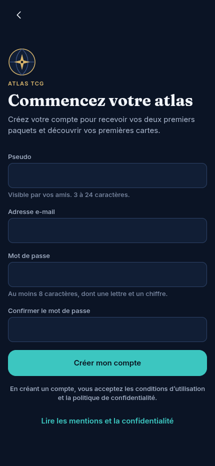

# Atlas TCG

**Le monde est à collectionner.**

Atlas TCG est un jeu mobile de cartes où chaque pays, capitale, monument et culture devient une carte à collectionner. Ouvrez des paquets, illuminez la carte du monde, partez en expédition et complétez votre atlas — sur iOS, Android et le web.

Expo SDK 58 · React Native · TypeScript · Expo Router · Supabase (PostgreSQL, Auth, RLS, Storage)

<p align="center">
  
  &nbsp;
  
  &nbsp;
  
</p>

<p align="center">
  
  &nbsp;
  
  &nbsp;
  
</p>

## Ce que fait l’application

| Pilier | Description |
| --- | --- |
| **Paquets** | Classique, Premium et Légendaire — 5 cartes par sachet, raretés du commun au mythique. Un nouveau compte démarre avec **14 classiques, 1 premium et 1 légendaire**. |
| **Collection** | ~995 cartes sur **199 pays** : pays, capitales, monuments, paysages, cultures. Filtres par rareté, continent, albums thématiques. |
| **Carte du monde** | Chaque pays découvert s’illumine. Les destinations d’expédition se tirent au sort (charges régénérées dans le temps). |
| **Expéditions** | Situer un pays, découvrir un lieu, répondre à un quiz — XP d’exploration, fragments et maîtrise par pays. |
| **Économie** | Doublons → fragments → boutique. Paquets minuteur (1 classique toutes les 10 min, réserve plafonnée). |
| **Social** | Pseudos, codes publics, amis. |

Le contenu éditorial vit dans `content/` (JSON) ; les migrations SQL et le seed généré vivent dans `supabase/`.

## Prérequis

- **Node.js** 20+ et npm
- Un projet **[Supabase](https://supabase.com)** (gratuit suffit pour démarrer)
- La CLI Supabase est fournie en dépendance de développement (`npx supabase` / scripts `db:*`)

## Lancer en local (votre propre Supabase)

Chaque contributeur utilise **son** projet Supabase : migrations + seed à appliquer une fois, puis l’app pointe dessus via `.env`.

### 1. Cloner et installer

```bash
git clone <url-du-depot> atlas
cd atlas
npm ci
cp .env.example .env
```

### 2. Créer le projet Supabase

1. Créez un projet sur [supabase.com](https://supabase.com/dashboard).
2. **Project Settings → API** : copiez l’**URL** du projet et la clé **publishable** / **anon** (jamais la clé secrète / `service_role` dans l’app).
3. Renseignez `.env` :

```env
SUPABASE_URL=https://xxxxxxxx.supabase.co
SUPABASE_PUBLIC_KEY=sb_publishable_…   # ou la clé anon JWT eyJ…

# Optionnel mais recommandé pour les liens e-mail (confirmation, reset) hors localhost :
EXPO_PUBLIC_APP_URL=http://localhost:8081
```

`app.config.ts` n’embarque que l’URL et la clé publique, et **refuse de builder** si une clé secrète est fournie par erreur.

### 3. Appliquer les migrations et le seed

```bash
npm run db:login    # autorise la CLI (navigateur)
npm run db:link     # choisir votre projet ; mot de passe de la base demandé
npm run db:push:dry # aperçu sans écrire
npm run db:push     # migrations manquantes + seed (catalogue, paquets, économie…)
```

La CLI mémorise ce qui est déjà appliqué : relancer `db:push` n’envoie que le nouveau.

### 4. Auth (e-mails de confirmation)

Dans **Authentication → URL Configuration** :

| Réglage | Exemple local | Exemple prod |
| --- | --- | --- |
| **Site URL** | `http://localhost:8081` | votre URL déployée |
| **Redirect URLs** | `http://localhost:8081/**`, `atlas://auth/callback`, `atlas://reset-password`, `exp://**` | idem + domaine prod |

Sans confirmation d’e-mail désactivée côté projet, l’inscription envoie vers l’écran « Validez votre e-mail » tant que le lien n’est pas cliqué.

### 5. Démarrer l’app

```bash
npx expo start
```

- **Web** : ouvrir `http://localhost:8081`
- **Appareil** : scanner le QR avec Expo Go
- Sans `.env` valide, l’app affiche un écran d’aide pour renseigner Supabase

### Illustrations (optionnel)

Le bucket public `card-illustrations` est créé par les migrations. Pour (re)générer / uploader les photos monuments :

```bash
# SUPABASE_SECRET_KEY uniquement pour ce script serveur, jamais dans l’app
npm run illustrations:monuments
npm run illustrations:upload
npm run content:build
npm run db:push
```

## Aperçu des écrans

| Écran | Aperçu |
| --- | --- |
| Connexion |  |
| Inscription |  |
| Accueil / paquets |  |
| Collection |  |
| Fiche carte |  |
| Carte du monde |  |
| Fiche pays |  |
| Bienvenue |  |

## Commandes utiles

```bash
npm run lint              # ESLint (Expo + React Compiler)
npm run typecheck         # tsc --noEmit
npm run content:check     # valide content/*.json
npm run content:build     # régénère supabase/seed.sql
npm test                  # tests app + contenu
npm run test:db           # migrations, RLS, RPC (PostgreSQL embarqué)
npm run verify            # lint + types + contenu + tous les tests
npm run export:android    # bundle Android
```

## Organisation du dépôt

```
src/app/            routes Expo Router (écrans)
src/design-system/  jetons et composants UI
src/features/       domaines (auth, packs, cards, world-map, expeditions…)
src/lib/            client Supabase, RPC, erreurs, env
content/            source éditoriale (pays, cartes, paquets, objectifs)
supabase/           migrations SQL, seed, config CLI
scripts/            build contenu, carte, illustrations
public/images/      captures pour la documentation
tests/              tests DB et contenu
```

## Licence / contribution

Projet personnel public : n’hésitez pas à forker, ouvrir des issues ou proposer des PR. Chaque fork doit pointer vers **son** projet Supabase (voir section « Lancer en local »).
